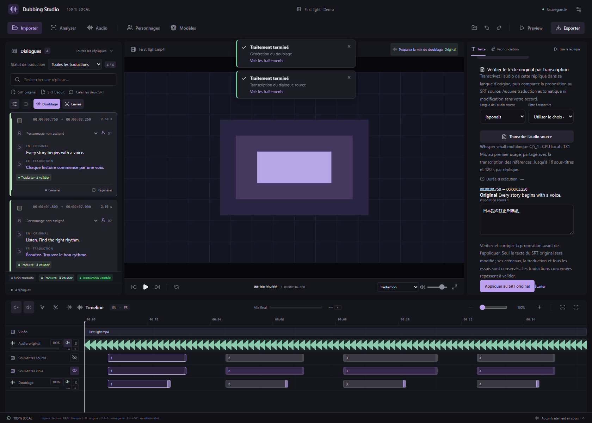
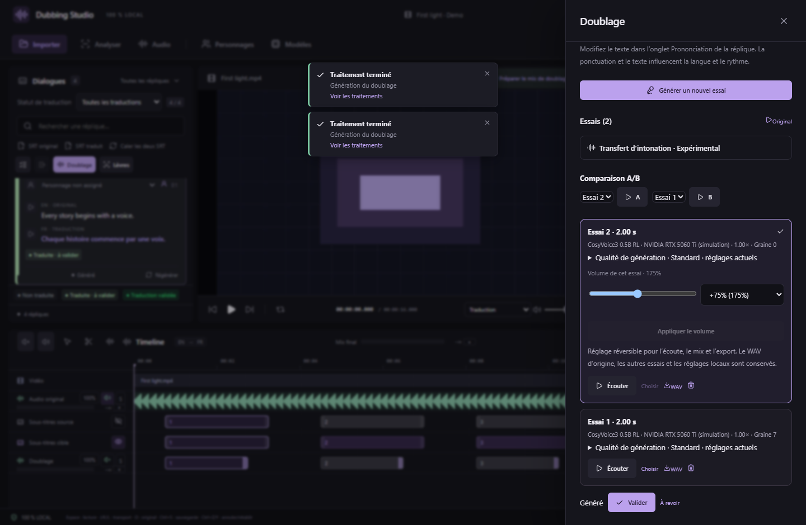

# Transcription source et volume des essais — v0.31.0

## Vérifier le SRT original

Sélectionnez une réplique, ouvrez **Aide à la traduction → Vérifier le texte original par transcription**. Choisissez la langue réellement parlée (japonais pour une source japonaise) et la piste à analyser. Le choix du projet privilégie la piste Voix lorsqu’elle existe ; sélectionnez Original, Musique ou Effets si la séparation a mal classé une voix.

**Transcrire l’audio source** utilise Whisper small multilingue Q5_1 sur le CPU, localement. Le modèle de 181 Mio est téléchargé au premier usage et réutilisé pour la transcription des références vocales. Aucun LLM de traduction n’est nécessaire. Le temps écoulé et l’annulation sont disponibles pendant le traitement.

Relisez chaque proposition à côté du texte original, corrigez-la, puis choisissez **Appliquer au SRT original**. Chaque sous-titre conserve son identifiant et ses créneaux propres, même si plusieurs sous-titres composent la réplique. Une réplique sans SRT original peut recevoir son premier texte sur ses créneaux actuels. La traduction et les essais audio restent conservés ; une traduction affectée doit être validée à nouveau. Ctrl+Z annule l’application.

La transcription reste une proposition : bruit, musique et voix superposées peuvent produire des erreurs. Une zone sans parole détectable conserve le texte original. Jusqu’à 16 sous-titres et 120 secondes cumulées sont acceptés par réplique. Si le texte source, les créneaux ou l’audio changent pendant l’analyse, relancez celle-ci avant d’appliquer.

## Volume de sortie avant et après génération

Dans **Doublage**, réglez **Volume de sortie des nouveaux essais**. Les mêmes préréglages sont disponibles pour le doublage par lot. **+50% signifie 150% du volume initial**, **+75% signifie 175%**. Le réglage va de 0% (muet) à 400%, avec un curseur au pourcent près. La valeur par défaut, 100%, conserve le comportement antérieur.

Pour un essai existant, sélectionnez-le dans la liste des essais, réglez **Volume de cet essai**, puis **Appliquer le volume**. Revenez à 100% pour rétablir son volume initial. Le changement est annulable et ne relance pas le moteur TTS.

Ce gain global s’applique à tout l’essai après ses découpes, volumes locaux, fondus et effets. Il reste indépendant du volume global de la piste Doublage et du volume d’écoute du lecteur. Il est pris en compte dans l’écoute seule, le mix synchronisé, l’export WAV et l’export MKV. Un limiteur retient les crêtes à environ −0,18 dBFS lorsque le gain change ; un niveau élevé peut donc réduire la dynamique. Une somme de plusieurs pistes peut encore saturer : surveillez le vumètre du mix final.

Le WAV généré d’origine reste intact. Les essais antérieurs, leur configuration de génération et leurs durées sont conservés. Les projets utilisant un gain non standard sont enregistrés au format 22 ; les anciens projets restent lisibles.

*Captures de l’interface réelle avec média synthétique et commandes natives simulées. Les rendus FFmpeg et la transcription japonaise sont aussi vérifiés dans les diagnostics Windows du paquet.*

## Contrôle MCP

125 outils et 22 schémas partagés. `studio_transcribe_dialogue_source` retourne un identifiant de tâche ; consultez `studio_list_jobs`, puis `studio_source_transcription_result`. `studio_latest_source_transcription` retrouve la dernière analyse. `studio_apply_source_transcription` exige une acceptation explicite et le contexte courant. `studio_set_voice_output_gain` règle un essai existant avec `gain` entre 0 et 4. `VoiceSettings.outputGain` règle les nouveaux essais et les lots. Pour les appels de rendu natifs acceptant `edit`, transmettez le `voiceEdits[id]` courant.

## English

Select a dialogue and open **Translation help → Check original text with transcription**. Choose the spoken language and audio track. Local Whisper returns editable, review-only proposals. Apply explicitly to update original SRT text while preserving cue IDs/timing, translated subtitles and all takes; affected translations need review again. Cancellation, stale-result checks and undo are supported.

Set output volume before single/batch generation, or select an existing take and apply its own volume. +50% means 150%, +75% means 175%; range 0–400%, default 100%. Originals stay immutable. Local edits, duration, fades and effects are preserved. A peak limiter protects the adjusted take; monitor the final mix when summing tracks. Listening, WAV and MKV export use the same rendered edit.
