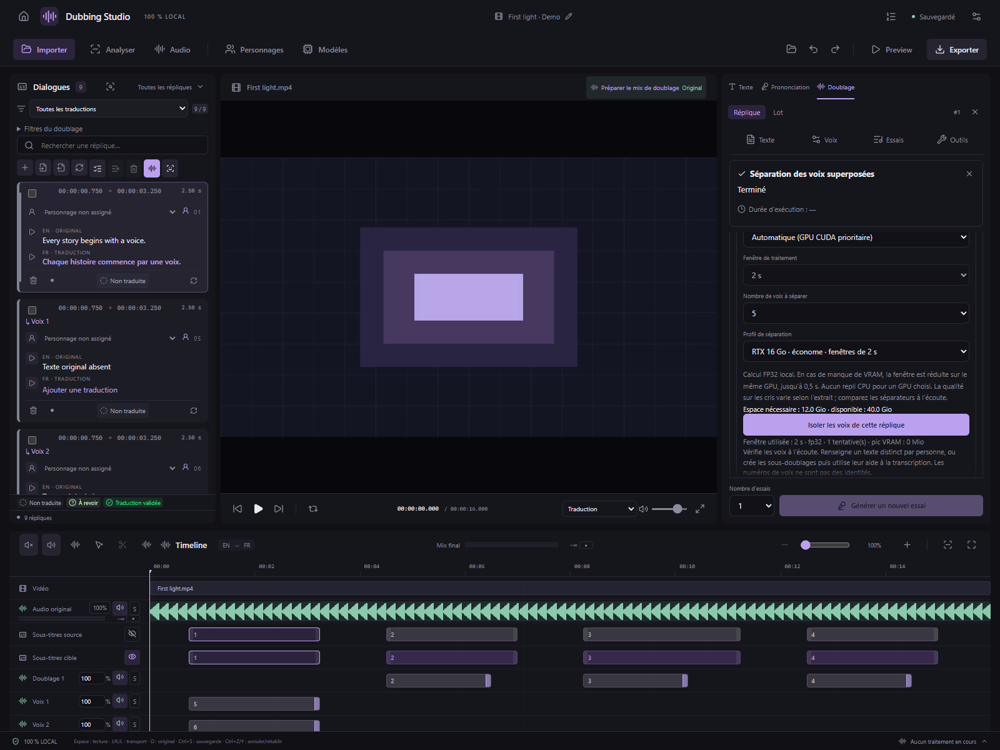

# TF-GridNet et SR-CorrNet en local — v0.57.0

Les séparateurs sont accessibles depuis **Doublage → Outils → Isoler plusieurs voix**, ainsi que dans la **boîte à outils Audio** d’une sélection libre. Installez le modèle choisi depuis ce panneau ; les poids sont vérifiés par taille et SHA-256, puis leur chargement réel est contrôlé. Le stockage utilise le dossier de modèles configuré. Le gestionnaire des modèles permet aussi de les supprimer.

| Modèle | Sorties à choisir | Usage à comparer |
|---|---|---|
| TF-GridNet WSJ0-2mix | 2 | Autre architecture pour deux voix superposées. Véritable checkpoint mono du tutoriel ESPnet/CMU, sans simuler des microphones supplémentaires. |
| SR-CorrNet WHAMR | 2 | Variante entraînée sur un corpus avec bruit et réverbération. |
| SR-CorrNet WSJ variable 2–3 | 2 ou 3 | Deux ou trois locuteurs sur l’extrait. |
| SR-CorrNet WSJ variable 2–5 | 2, 3, 4 ou 5 | Davantage de voix simultanées. |

Le nombre de sorties est un choix manuel. Indiquez le nombre réel de voix ; demander cinq sorties pour deux personnes peut créer des résidus. Les numéros de sortie ne sont pas des identités de personnages et doivent être vérifiés à l’écoute. Tous ces checkpoints travaillent à **8 kHz** ; leurs sorties sont rééchantillonnées en PCM mono 48 kHz pour les pistes et préécoutes du studio. La séparation garde la parole d’origine, sans traduction implicite.

## Réglages pour la RTX 5060 Ti de 16 Go

- **Périphérique : NVIDIA GeForce RTX 5060 Ti**, ou **Automatique (GPU CUDA prioritaire)**. Automatique interroge réellement PyTorch au lancement ; un GPU CUDA explicitement choisi n’est jamais remplacé par le CPU lors d’un échec.
- **RTX 16 Go · économe** : fenêtres de 2 secondes avec chevauchement, calcul FP32. Point de départ conseillé lorsque d’autres applications utilisent de la VRAM.
- **Contexte plus long** : fenêtres de 4 secondes, avec davantage de contexte et de mémoire utilisée. Comparez à l’écoute ; davantage de contexte ne garantit pas un meilleur résultat.
- **Manuel** : fenêtre de 2, 4, 6 ou 8 secondes.

En cas d’erreur CUDA de mémoire, le calcul recommence sur **le même GPU**, avec une fenêtre divisée par deux, jusqu’à 0,5 seconde. L’interface affiche la fenêtre réellement utilisée, le nombre de tentatives et le pic de mémoire alloué par PyTorch. Les poids ne sont pas rechargés à chaque fenêtre. Le processus se termine à la fin ou à l’annulation pour libérer ses ressources.

Le moteur fourni reste **PyTorch 2.8 / CUDA 12.8**, isolé des autres environnements. Les deux nouveaux moteurs utilisent les dépendances déjà prévues pour les séparateurs ; un environnement existant complet est réutilisé. L’installation de chaque nouveau checkpoint vérifie son architecture puis actualise la liste des périphériques.

La grille de positionnement de SR-CorrNet est calculée uniquement pour les dimensions de la fenêtre traitée, avec les mêmes valeurs sinusoïdales. Cela évite la préallocation amont de `5000 × 1500 × 128` flottants, soit environ 3,6 Gio. La reconstruction auxiliaire des résidus d’entraînement inutilisée en inférence est omise. Les sorties sont alignées entre fenêtres, y compris en cas d’inversion de polarité, pour limiter annulations et transitions audibles.

## Écouter et placer les résultats

Écoutez les sorties, gardez celles qui conviennent, attribuez éventuellement un personnage puis choisissez **Utiliser les voix pour → Placer sur des pistes de doublage**. Chaque voix peut rejoindre une piste existante ou une piste indépendante. Les sous-dialogues préparés pour cette séparation sont réutilisés ; ceux qui manquent sont créés au même timestamp.

Les cinq voix peuvent être affichées simultanément : la timeline ajuste ses rangées à chaque piste et compacte une voix seule sur une piste indépendante. Les essais précédents, les SRT et la vidéo principale sont conservés. Les nouveaux fichiers sont enregistrés ensemble, avec une durée exacte ; une erreur annule le clic et retire ses seuls fichiers nouveaux. **Ctrl+Z** permet d’annuler.

Pour écouter le résultat avec la vidéo, préparez le mix de doublage et ajustez ou coupez la piste source afin d’éviter une écoute en double. Vous pouvez ensuite traduire et générer séparément les voix françaises à partir de chaque sous-dialogue isolé. [Guide du placement](ISOLATED-DUBBING-TRACKS.md).

## Limites et vérifications

Les tests exécutent les vrais poids sur huit configurations, avec cinq extraits vocaux publics et figés : 2 voix pour TF-GridNet et WHAMR, 2–3 pour SR-CorrNet 2–3, 2–5 pour SR-CorrNet 2–5. Ils vérifient l’amélioration SI-SDR par rapport au mélange de ces extraits, le calcul hors ligne, les fichiers non muets, les empreintes, les échantillons exacts et la conservation de la source. Un diagnostic de l’application Windows empaquetée utilise aussi le SDK MCP officiel pour installer/vérifier les modèles, séparer, placer, annuler/rétablir et rouvrir les projets.

**La qualification neuronale automatisée est réalisée sur CPU.** Les essais de réduction de fenêtre en cas d’OOM sont simulés ; les performances, la VRAM exacte et la qualité des cris sur une RTX 5060 Ti physique restent à mesurer. Les résultats sur ces extraits de parole ne constituent pas une validation sur vos scènes de cris ou d’anime. Une piste Voix préalablement nettoyée et une sélection avec un peu de contexte peuvent aider ; comparez les modèles sur votre scène.

## Sources et reproductibilité

- [TF-GridNet / ESPnet](https://github.com/espnet/espnet), code figé à `88c06552015f2877a0508281509e697a706c3006`, licence Apache-2.0 incluse. Checkpoint mono publié dans le [tutoriel ESPnet/CMU](https://kan-bayashi.github.io/espnet/notebook/SpeechEnhancement_CMU_11492_692_Spring2023(Assignment7).html), archive originale vérifiée, téléchargée directement depuis sa source. L’adaptateur STFT utilise les tenseurs complexes natifs de PyTorch pour charger les poids exacts sans installer la suite d’entraînement ESPnet.
- [SR-CorrNet-SS](https://github.com/dmlguq456/SR_CorrNet_SS), code figé à `7340365b9cc9a021bf7d400f52fce4b88593b67a`, licence MIT incluse. Les poids de l’auteur sont téléchargés depuis les dépôts Hugging Face `shinuh`, à leurs révisions et empreintes figées. Les conditions des checkpoints sont celles de leurs sources ; les binaires du studio n’embarquent pas ces poids.
- [Manifestes des poids](../workers/speaker-separation-models.json), [provenance des sous-ensembles d’inférence et modifications](../workers/vendor/spectral-separation/sources.json), [test neuronal reproductible](../scripts/test-spectral-separation.py). Aucun téléchargement de code n’est effectué à l’inférence.

## MCP et projets

Les **177 outils / 37 schémas** restent disponibles. `studio_separate_dialogue_speakers` accepte maintenant `options.speakerCount` et `options.memoryProfile` (`gpu16`, `quality`, `manual`), en plus des champs habituels. Les nouveaux modèles utilisent deux sorties par défaut ; le nombre demandé doit appartenir au checkpoint. Un GPU explicite utilise `cuda:0`, `cuda:1`, etc. `auto` choisit le premier CUDA disponible, sinon le CPU.

`studio_speaker_separation_result` retourne les sorties réellement demandées, le périphérique réel, la précision, la fenêtre effective, les tentatives et le pic VRAM. `studio_place_speaker_dubbings` et `studio_create_speaker_dubbings` acceptent les sorties correspondantes, jusqu’à cinq pour le modèle 2–5. Les nouveaux groupes et leurs pistes d’essais utilisent le **format projet 35** ; les anciens formats restent lus. Les profils et le nombre de locuteurs sont figés avec la demande enregistrée.
