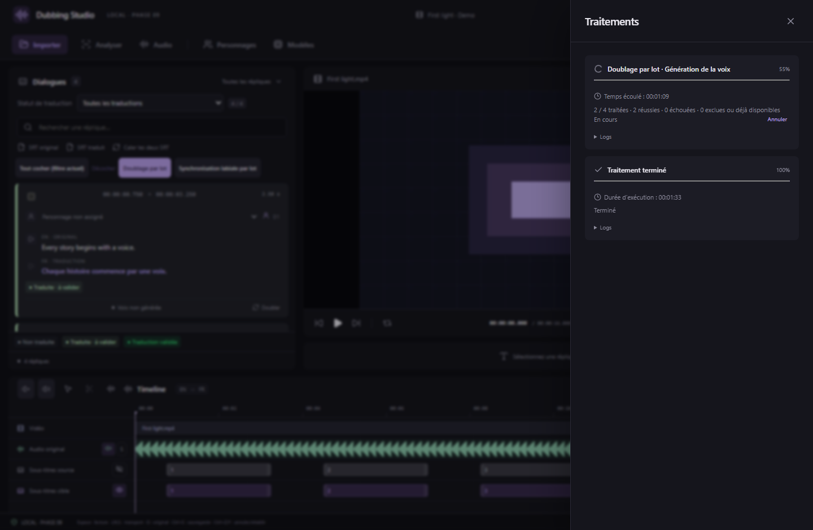

# Durée des traitements — v0.25.0

Ouvrez **Traitements** depuis la barre inférieure pour voir la durée de chaque tâche. **Temps écoulé** avance en direct pendant l’exécution, même quand aucun nouveau log ni pourcentage n’arrive. Le compteur de la tâche active reste aussi visible dans la barre inférieure et dans les panneaux qui affichent sa progression.

À la fin, **Durée d’exécution** conserve le temps mesuré, que la tâche ait réussi, échoué ou été annulée. Le format est **heures:minutes:secondes** ; les longues installations peuvent dépasser 24 heures sans remise à zéro.

- L’attente dans la file et les pauses sont exclues. Une reprise continue le compteur.
- Le changement d’étape ou de réplique dans un lot ne remet pas le compteur à zéro. La durée du lot couvre son exécution entière, y compris le chargement et la libération du modèle.
- Réessayer crée une nouvelle tâche avec un nouveau compteur ; la durée précédente reste dans son historique.
- Fermer puis rouvrir le panneau ne modifie pas la mesure.
- Les durées sont conservées dans le journal local des traitements, indépendamment du projet. Un point de contrôle est enregistré environ toutes les cinq secondes pendant l’exécution pour limiter la perte en cas d’arrêt inattendu. Après redémarrage, les tâches interrompues gardent le dernier temps enregistré ; le temps pendant lequel le studio était fermé n’est pas ajouté.
- Les anciennes tâches sans durée enregistrée affichent **—**.

Le temps d’exécution est mesuré avec une horloge monotone native, indépendante du réglage de l’heure Windows. L’animation du compteur utilise aussi une horloge monotone. Aucun temps restant estimé n’est déduit du pourcentage.

Le MCP expose la même mesure dans `studio_list_jobs` et l’état du studio : `timing.elapsedMs` est la durée active en millisecondes à l’instant `timing.observedAtMs` (horodatage Unix en millisecondes). Elle continue seulement si `status` vaut `running`. `timing` est absent pour les anciennes tâches non mesurées.

La capture montre l’interface réelle avec des commandes natives simulées. Les tests natifs vérifient séparément la mesure, les pauses, les états finaux, les reprises et la persistance.
