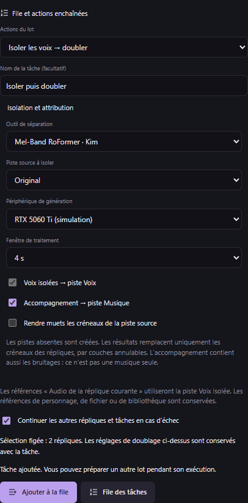
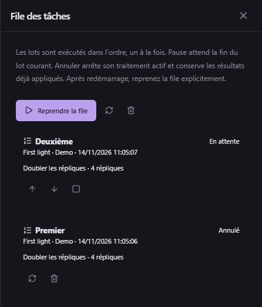

# Isolation en lot et file de traitements — v0.50.0

## Créer un lot

Sélectionnez les répliques à traiter, ouvrez **Doublage → Lot**, puis réglez le moteur, la référence, la qualité, l’humeur, la vitesse, la graine, le volume et le nombre d’essais (1 à 4). Le bouton de doublage immédiat reste disponible. La section **File et actions enchaînées** propose :

- **Doubler les répliques** : ajouter un lot de doublage avec ses réglages propres.
- **Isoler les voix** : séparer les créneaux des répliques et attribuer les sorties choisies.
- **Isoler les voix → doubler** : terminer les isolations, puis doubler les répliques dont l’isolation a réussi.

Le choix toutes/sélectionnées et les filtres de validation de traduction sont communs au lot. La sélection est figée à l’ajout : sélectionner d’autres répliques ensuite ne change pas une tâche déjà enregistrée. Le doublage conserve sa politique de traduction, de validation et de nouveaux essais forcés ; les répliques sans traduction ne sont pas doublées. L’isolation seule peut aussi traiter des répliques non traduites.

**Ajouter à la file** conserve le panneau ouvert. Vous pouvez choisir d’autres réglages et ajouter un autre lot pendant l’exécution. Chaque tâche conserve son nom, sa date/heure, sa sélection et sa configuration.

## Isolation et attribution automatiques

Choisissez **Mel-Band RoFormer · Kim Vocals** ou **BS-RoFormer · Viperx 1297**, une piste source, le périphérique et une fenêtre de traitement de 2 à 8 s. Ces outils doivent être installés depuis **Audio → Isolation de la sélection**. Une fenêtre de 4 s constitue le profil déjà proposé pour 16 Go de VRAM ; la consommation dépend du modèle et du contenu.

- **Voix isolées → piste Voix** : attribuer la sortie vocale au même timestamp.
- **Accompagnement → piste Musique** : attribuer l’accompagnement au même timestamp.
- Choisir une sortie ou les deux. L’enchaînement avec doublage impose la sortie Voix.
- **Rendre muets les créneaux de la piste source** est facultatif et désactivé par défaut. Cela évite un double mix si vous écoutez aussi les nouvelles pistes.

L’accompagnement contient la musique **et éventuellement les bruitages** ; ce n’est pas une séparation musique/SFX. Une piste de rôle approprié est réutilisée pour le média courant, ou créée si elle manque. Chaque sortie remplace uniquement le créneau de sa réplique par une couche réversible. Le reste de la piste, la vidéo principale, les fichiers source et les anciens essais restent intacts. Les applications aux pistes et les nouveaux essais conservent leur historique d’annulation habituel ; annuler une tâche ne retire pas les résultats déjà enregistrés.

Chaque réplique isolée doit durer **0,1 à 60 secondes** et rester dans le média. Une sélection contenant une plage invalide est refusée avant lancement ; corrigez ou retirez cette réplique. L’isolation est exécutée réplique par réplique ; la fenêtre de traitement ne change pas leurs timestamps. Dans un groupe de sous-doublages, le projet entier traite le parent une seule fois pour l’isolation ; le lot vocal garde l’expansion en sous-répliques du studio.

Pour le doublage enchaîné, **Audio de la réplique courante** utilise la nouvelle piste Voix. Les références de personnage, de fichier ou de bibliothèque restent celles que vous avez choisies. L’audio d’entrée est préparé au démarrage de l’étape : les couches appliquées par une étape précédente peuvent ainsi servir à la suivante. Une isolation en échec n’est jamais remplacée silencieusement par la piste d’origine pour le doublage.

## Gérer la file

Le pictogramme de liste dans l’en-tête ou le bouton **File des tâches** ouvre le suivi. Un seul workflow s’exécute à la fois. Les modèles de séparation sont libérés avant le doublage ; le moteur vocal reste chargé pendant son lot selon le fonctionnement existant, puis est libéré à sa fin ou à son annulation.

- Les flèches avancent/reculent les tâches en attente.
- **Pause après le lot courant** laisse le workflow actif se terminer, puis bloque les suivants.
- **Annuler cette tâche** arrête le traitement enfant actif, ou retire une tâche en attente de l’exécution. Les résultats déjà appliqués restent conservés.
- **Reprendre les étapes inachevées** conserve les isolations réussies et relance les essais vocaux inachevés via leur historique. Les identités d’essais de la file sont stables pour éviter des doublons après une interruption entre génération et sauvegarde du suivi.
- **Retirer cette tâche** et **Retirer l’historique terminé** retirent le suivi, sans supprimer les fichiers du projet ni annuler les montages.

**Continuer les autres répliques et tâches en cas d’échec** est activé par défaut. Si vous le désactivez, un échec arrête le workflow et met la file en pause. Le résumé affiche les incidents d’isolation et donne accès aux rapports de doublage détaillés pour écouter les essais et retrouver leurs erreurs. L’application utilise des résumés compacts pour les mises à jour de progression, sans retransmettre tous les textes et références des projets.

## Redémarrage et changements de projet

La file et les réglages sont stockés dans les données de l’application, séparément du projet. Après redémarrage, elle est **toujours en pause** ; le workflow qui était actif est marqué **interrompu**. Ouvrez son projet, reprenez ses étapes inachevées, puis reprenez la file explicitement. Le studio ne rouvre pas d’autres projets et ne lance pas de génération à votre insu. Si le prochain workflow appartient à un autre projet, la file attend son ouverture.

Les textes, créneaux, personnages, références enregistrées et identité du média sont contrôlés avant exécution. S’ils ont changé, recréez le lot avec les nouveaux réglages. Les changements de statut de contrôle manuel n’invalident pas ce contexte. La file accepte 200 tâches et un journal de 32 Mio ; retirez l’historique ancien si cette limite est atteinte. Le format des projets reste inchangé (**29 au maximum**).

## Pilotage IA et validation

Les quatre nouveaux outils sont `studio_task_queue_status`, `studio_task_queue_entry`, `studio_enqueue_workflow` et `studio_control_task_queue`. Les commandes d’ajout/gestion demandent le contexte courant. Les pages de détail sont limitées à 200 lignes ; les IDs retournés dans leur sélection sont ceux de cette page. **170 outils MCP / 33 schémas partagés.**

Les tests Windows du moteur utilisent de vrais WAV, l’attribution native aux pistes et un protocole vocal synthétique pour vérifier l’ordre, le moteur chaud du lot, la conservation des sources/anciens essais, la reprise sans doublons et l’annulation d’un processus. Le diagnostic du portable utilise le SDK MCP officiel et un redémarrage réel, avec interruption injectée dans un dossier de test isolé. Ces vérifications ne téléchargent pas les poids neuronaux et ne constituent pas un benchmark de qualité ou de vitesse sur une RTX 5060 Ti.

Les captures montrent l’interface réelle avec une session de test et des commandes natives simulées. Une erreur d’enregistrement du journal met aussi la file en pause et empêche le lancement des tâches suivantes ; libérez de l’espace avant de reprendre.
