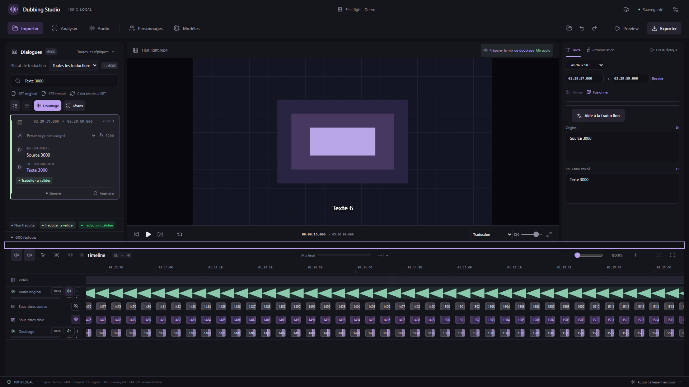

# Fluidité de la timeline sur les longues vidéos — v0.28.1

Le dézoom complet d’un film pouvait monter simultanément des milliers de boutons de sous-titres et de doublage. Le filtre des éléments visibles n’éliminait alors aucun de ces blocs, ce qui alourdissait le travail du navigateur pendant la lecture.

La timeline s’ouvre maintenant sur **deux minutes au maximum** pour les longues vidéos. Les vidéos de deux minutes ou moins restent affichées entièrement. Vous pouvez toujours zoomer davantage, défiler horizontalement ou cliquer sur une réplique pour rejoindre sa position. Les limites de zoom détaillé restent adaptées à la durée du film.

- **Ctrl + molette**, **Ctrl + + / −**, curseur et boutons respectent la même limite minimale.
- **Maj + Z** et le bouton **Vue d’ensemble limitée à 2 min** cadrent deux minutes autour de la tête de lecture sur un film long. Sur une vidéo courte, ils conservent le comportement **Tout afficher**.
- Les commandes MCP `studio_preferences` avec `zoom: 1` ou `zoom: "fit"` respectent aussi cette limite d’affichage.
- La borne est appliquée dès le premier rendu, à l’ouverture ou au changement du projet, et après redimensionnement de la fenêtre. Les pourcentages restent relatifs à la durée totale : 15 000 % sur un film de cinq heures correspondent à deux minutes visibles.

Les formes d’onde conservent leurs crêtes exactes. Une pyramide de maxima est calculée une seule fois quand leurs données arrivent ; chaque pixel interroge ensuite des groupes de crêtes sans reparcourir toute la piste à chaque défilement. La liste des doublages est aussi mémorisée tant que le projet ne change pas. Pendant la lecture sans défilement, les formes d’onde statiques ne sont pas redessinées.

Ce correctif ne modifie ni la vidéo, ni les WAV, ni les temps des répliques, ni le mix ou les exports. Il réduit le travail d’affichage de la timeline. Les difficultés propres au décodage vidéo ou au pilote graphique peuvent nécessiter les réglages de fluidité déjà disponibles dans Paramètres.

La vérification Chrome utilise un projet synthétique de cinq heures : 6 000 répliques, 12 000 blocs SRT, 6 000 doublages et 200 000 crêtes audio par forme d’onde. Moins de 135 blocs sont montés simultanément au dézoom maximal, sans montage transitoire des 18 000 blocs. Les tests couvrent les raccourcis, la molette, le curseur, les commandes d’interface utilisées par MCP, le début et la fin du film, une réplique éloignée, le redimensionnement et l’absence de modification du projet. Une vidéo réelle de démonstration continue à avancer sans nouveau dessin des formes d’onde statiques ; ce test n’est pas une mesure des images perdues sur le PC RTX de l’utilisateur. La capture montre cette interface réelle avec média synthétique et commandes natives simulées.

[Commandes de zoom](TIMELINE-ZOOM.md) · [Disposition des panneaux](COMPACT-WORKSPACE.md)
