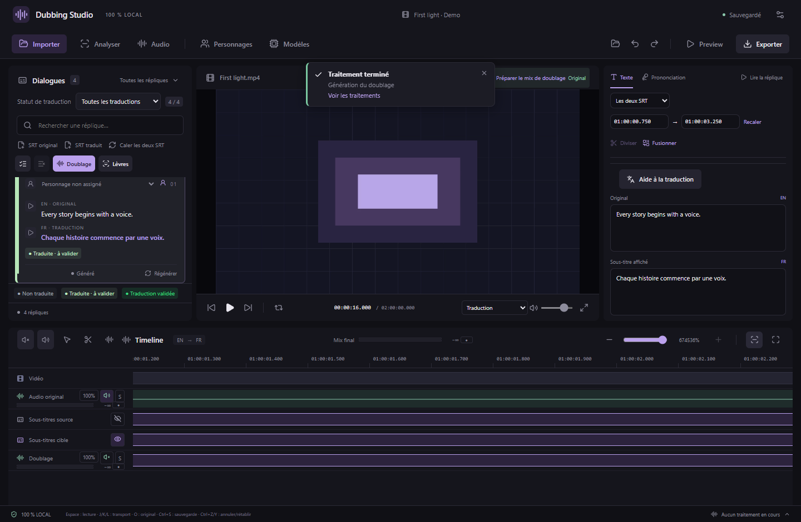

# Zoom précis de la timeline — v0.28.1

| Commande | Résultat |
| --- | --- |
| **Ctrl + molette** au-dessus des pistes | Zoom autour du temps sous le pointeur. Le zoom de la page est bloqué pour ce geste. |
| **Ctrl + +** ou **Ctrl + =** | Zoom avant autour de la tête de lecture si elle est visible, sinon autour du centre de la vue. Le pavé numérique est accepté. |
| **Ctrl + −** | Zoom arrière avec le même point de référence. |
| **Maj + Z** | Vidéos de 2 minutes au plus : affiche toute la timeline. Vidéos longues : revient à une fenêtre de 2 minutes autour de la tête de lecture. |
| Curseur de zoom, boutons **+ / −** | Même contrôle depuis la barre de la timeline. |
| **Zoom sur la réplique** | Cadre la voix choisie à son emplacement réel, ou les sous-titres si elle n’est pas générée. |

La molette avec Ctrl reprend la commande [documentée par CapCut](https://www.capcut.com/help/multiple-captions-in-export-video). Les autres commandes donnent un ensemble familier pour le montage desktop ; les raccourcis de zoom restent inactifs pendant la saisie et dans les panneaux de dialogue.

Le dézoom est limité à une fenêtre de deux minutes pour les longues vidéos afin de ne pas afficher tous leurs blocs simultanément. Cette limite s’applique au curseur, aux raccourcis, à la molette et au MCP. [Fluidité sur les longues vidéos](TIMELINE-PERFORMANCE.md).

La limite précédente de 100× a été remplacée par un zoom adapté à la durée de la vidéo. La règle affiche les millisecondes à fort grossissement, y compris au-delà de la première heure. Seuls les repères et blocs de sous-titres visibles sont créés à ce niveau de zoom. Défilez horizontalement pour retrouver un bord hors champ, ou utilisez Zoom sur la réplique pour cadrer le bloc entier.

Sur la piste **Doublage**, glissez le corps du bloc pour déplacer la voix et son bord droit pour l’allonger ou la raccourcir. **Flèche gauche/droite** ajuste son départ de 10 ms ; **Maj + flèche** de 1 ms. **Maj pendant un déplacement** active l’aimantation. Les réglages numériques et les remises à zéro restent dans Doublage.

Capture réelle React/Chrome avec métadonnées d’un film de deux heures simulées et la vidéo géométrique de démonstration. Les tests vérifient le temps conservé sous la souris, la position de la tête de lecture, l’absence de zoom de page et la règle au-delà d’une heure.

[Calage visuel des lèvres](LIP-ALIGNMENT.md) · [Placement et durée](DUBBING-PLACEMENT.md).
