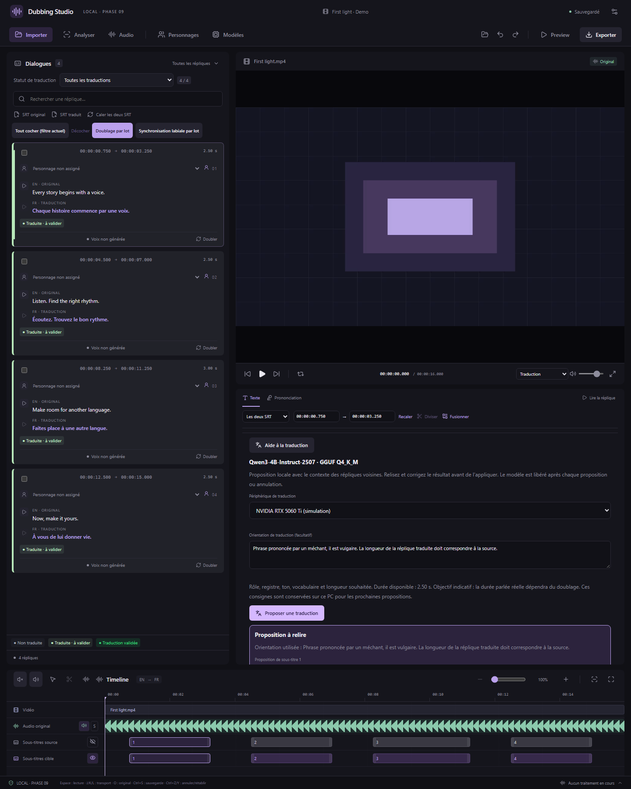

# Filtres, validation et aide locale à la traduction

Disponible depuis **v0.13.0**. Les projets gardent leur format existant ; la validation de traduction introduite en v0.12.0 utilise le format 10.

## Filtrer les répliques

Dans **Dialogues → Statut de traduction**, choisissez :

- **Toutes les traductions** : toutes les répliques.
- **Non traduite** : gris, sans texte traduit (un texte de prononciation seul ne suffit pas).
- **Traduite · à valider** : vert clair, texte traduit présent sans approbation actuelle.
- **Traduction validée** : vert, texte explicitement approuvé.

Le filtre se combine à la recherche textuelle et au filtre existant des répliques à vérifier. Le compteur indique le nombre affiché et le total. **Tout cocher (filtre actuel)** coche les répliques visibles après filtrage ; changer de filtre ne décoche pas la sélection existante. Le filtre ne modifie aucun sous-titre.

## Doubler les traductions validées

Ouvrez **Doublage par lot**, choisissez toutes les répliques ou la sélection cochée, puis activez **Uniquement les traductions validées**. Cette option se combine aux réglages habituels : modèle vocal, référence, GPU, humeur, accent, vitesse, graine et forçage d’un nouvel essai.

L’aperçu dénombre les traductions manquantes, non validées, essais déjà disponibles et références invalides. Même avec **Forcer**, une traduction non validée reste exclue. Retirer une validation pendant le lot ou avant sa reprise arrête le lot avant de générer cette réplique. Les essais réussis sont conservés ; validez à nouveau le texte puis reprenez, ou préparez un nouveau lot adapté.

La validation concerne le texte original, le texte traduit et les langues. Corriger ces textes ou changer de langue la retire ; corriger uniquement les timings ou la prononciation la conserve. Elle est indépendante de la validation des essais vocaux.

## Proposer une traduction avec un petit LLM local

1. Sélectionnez une réplique contenant son texte original et ouvrez l’onglet **Texte** de l’éditeur.
2. Cliquez sur **Aide à la traduction**, puis **Installer le modèle de traduction**. L’interface affiche le dossier, l’espace nécessaire et disponible avant de lancer le téléchargement.
3. Une fois installé, choisissez **NVIDIA GeForce RTX 5060 Ti** dans **Périphérique de traduction**. Le moteur utilise Vulkan, avec une seule carte explicitement sélectionnée. Le CPU est aussi proposé. Un pilote Vulkan fonctionnel est nécessaire pour utiliser un GPU ; l’installation ne demande pas de kit CUDA.
4. Depuis v0.24.0, renseignez **Orientation de traduction (facultatif)** : par exemple « Phrase prononcée par un méchant, il est vulgaire. Il faut que la longueur de la réplique traduite corresponde à la source ». Les consignes sont mémorisées localement sur ce PC et réutilisées aux prochaines propositions ; effacez-les pour revenir au comportement standard. Elles peuvent préciser le personnage, le niveau de langage, le ton, les termes à conserver et la concision. Le modèle reçoit les créneaux de la réplique et des sous-titres cibles. Il vise une durée parlée adaptée, avec une longueur indicative : le nombre de caractères japonais n’est pas une mesure de durée française, et le temps réel dépend ensuite du moteur vocal. Les consignes utilisées restent affichées avec la proposition.

5. Cliquez sur **Proposer une traduction**. Les langues viennent du projet. Le modèle utilise la réplique sélectionnée et un bref contexte original avant/après ; il ne traduit pas tout le film.
6. Relisez et modifiez les propositions dans les champs dédiés, puis cliquez sur **Appliquer la proposition**, ou **Écarter**. Les sous-titres existants restent inchangés jusqu’à l’application.
7. Validez ensuite la traduction avec son badge vert clair si elle vous convient. Une proposition appliquée n’est jamais automatiquement approuvée.

*Interface React réelle ; inventaire natif et proposition affichée simulés pour la capture. Les essais réels du modèle local sont consignés dans VALIDATION.md.*

L’application conserve les créneaux de chaque sous-titre cible. S’il y en a plusieurs dans une réplique, une proposition distincte est fournie pour chacun, dans le même ordre. S’il n’y en a aucun, l’application crée un sous-titre dans le créneau de la réplique. Les essais vocaux, références et réglages de prononciation ne sont pas effacés. Une prononciation personnalisée existante reste à vérifier séparément après une nouvelle traduction.

Si vous corrigez le texte, changez de langue ou réassociez les sous-titres ou changez leurs créneaux pendant l’attente, l’ancienne proposition devient inapplicable : demandez-en une nouvelle pour conserver vos corrections. Les propositions sont enregistrées localement et récupérables en rouvrant l’aide de la réplique. **Annuler** arrête la génération sans appliquer de texte.

## Modèle, stockage et mémoire

- **Qwen3-4B-Instruct-2507**, modèle multilingue sans phase de raisonnement, quantification **GGUF Q4_K_M** publiée par LM Studio Community : **2 497 280 448 octets**, soit **2,33 Gio** de poids. C’est un modèle généraliste compact adapté à des propositions à relire ; ce n’est pas une garantie d’exactitude de traduction. Vérifiez notamment les noms, pronoms, registres et références culturelles.
- **llama.cpp b11718**, archive Windows x64 Vulkan/CPU de 32,3 Mo, installée automatiquement. Aucun Python, Ollama, compte ni clé d’API n’est nécessaire.
- Les poids occupent moins de mémoire que les versions pleine précision ; la VRAM totale inclut aussi le contexte et les buffers. Le profil est prévu pour une carte de 16 Go, avec un contexte limité à 8 192 tokens, une seule requête et un seul GPU. Cette version ne fournit pas de benchmark RTX 5060 Ti.
- L’installation se trouve dans **le dossier configuré pour les modèles**, sous `translation-llm`. Le changement de dossier déplace également ce modèle et son moteur. Les propositions sont stockées dans les données locales de l’application, sans copies des poids dans les projets.
- Les téléchargements ont une révision fixe, une taille exacte et un SHA-256 vérifiés. Le moteur et le modèle sont contrôlés avant usage. Le budget disque tient compte des téléchargements déjà présents et réserve une marge pour l’extraction.
- Le serveur d’inférence est privé, lié à `127.0.0.1` sur un port temporaire avec une clé aléatoire et l’interface web désactivée. Le texte et les médias ne sont pas envoyés à un service de traduction. Internet sert à l’installation initiale ; les propositions sont ensuite locales.
- Le modèle est chargé pour une proposition, puis son processus est arrêté et attendu avant de terminer le traitement, y compris lors d’une annulation ou d’un échec. Les tâches de calcul utilisent la même file que le doublage pour limiter la concurrence en VRAM.

## Sources et licences

Sources consultées le 18 octobre 2026 :

- [Fiche officielle Qwen3-4B-Instruct-2507](https://huggingface.co/Qwen/Qwen3-4B-Instruct-2507) — modèle multilingue 4B, sans raisonnement, licence Apache 2.0.
- [Quantification LM Studio Community](https://huggingface.co/lmstudio-community/Qwen3-4B-Instruct-2507-GGUF/tree/4edb920b6f14e3b9284d4502a6485103d72cde05) — révision et fichier Q4_K_M épinglés.
- [Moteur llama.cpp b11718](https://github.com/ggml-org/llama.cpp/releases/tag/b11718) — licence MIT et notices incluses dans l’archive installée.
- [API et sélection des périphériques llama.cpp](https://github.com/ggml-org/llama.cpp/blob/b11718/tools/server/README.md) — sorties JSON contraintes, modèle local et choix explicite du périphérique.

## Orientation de traduction

Interface React réelle avec commandes natives simulées pour cette capture. Validation du modèle local réel : voir VALIDATION.md.
