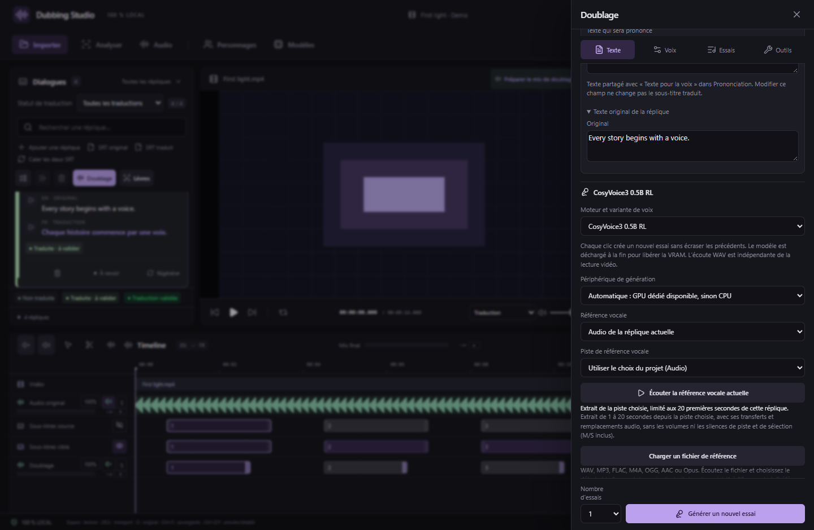
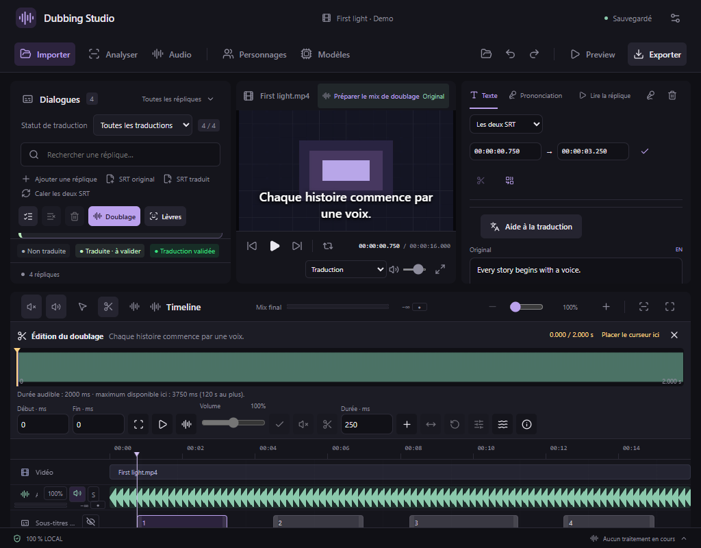
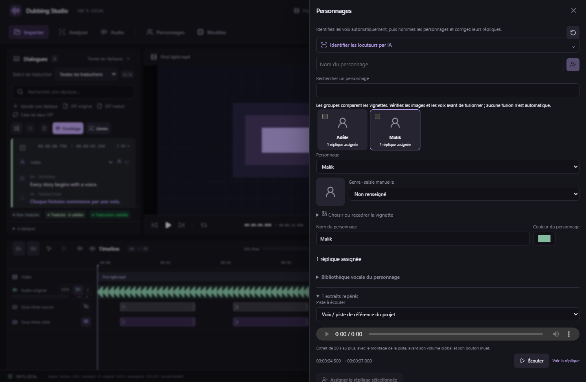

# Interface compacte — v0.37.0

L’agencement général reste le même : dialogues à gauche, lecteur au centre, édition des sous-titres à droite et timeline sur toute la largeur. Les séparateurs et préférences de largeur restent disponibles.

## Doublage

Le texte à prononcer et le texte original arrivent en premier. La barre **Texte / Voix / Essais / Outils** rejoint directement chaque zone. Le nombre d’essais et l’action de génération restent en bas du panneau pendant le défilement. Les outils complémentaires (personnage proposé, microphone, timbre, séparation des voix et calage) sont réunis après la configuration vocale ; leurs sections conservent leurs réglages.

La progression reste dans le panneau et le nouvel essai reçoit le focus à la fin. Les essais précédents restent présents. Les actions secondaires des essais utilisent des pictogrammes ; les actions principales gardent un intitulé court.

## Édition dans la timeline

La forme d’onde, le curseur de lecture et la barre d’actions restent dans un dock compact au-dessus des pistes. Les bornes de sélection, la préécoute, le volume, le silence, la suppression, l’insertion et l’étirement gardent leurs commandes. Les réglages des **Fondus** et des **Effets audio** s’ouvrent dans des fenêtres dédiées ; **Échap** revient à l’éditeur. Les opérations restent annulables et les WAV d’origine restent conservés.

Les actions sur une sélection de piste utilisent aussi des pictogrammes : préécoute, muet, volume normal, outils audio, échange de piste et identification locale. Les boutons de recalage, division et fusion des sous-titres sont regroupés sous forme de pictogrammes.

## Personnages

La création, la recherche et la galerie prennent le premier plan. L’analyse vocale est repliée au départ, et s’ouvre lorsqu’une proposition d’analyse est disponible. Les cartes sont plus compactes et gardent le personnage actif bien visible. Les commandes d’ajout, d’assignation par plage et de remise à zéro utilisent des pictogrammes ; la remise à zéro garde sa confirmation explicite et ses deux modes.

Tous les nouveaux boutons à pictogramme disposent d’un nom accessible et d’une infobulle. Le clavier, les validations, les essais, les références et les traitements audio restent disponibles. Le format de projet reste **26**, avec **143 outils MCP**. Les moteurs audio, les modèles et leurs paramètres ne changent pas dans cette version.
