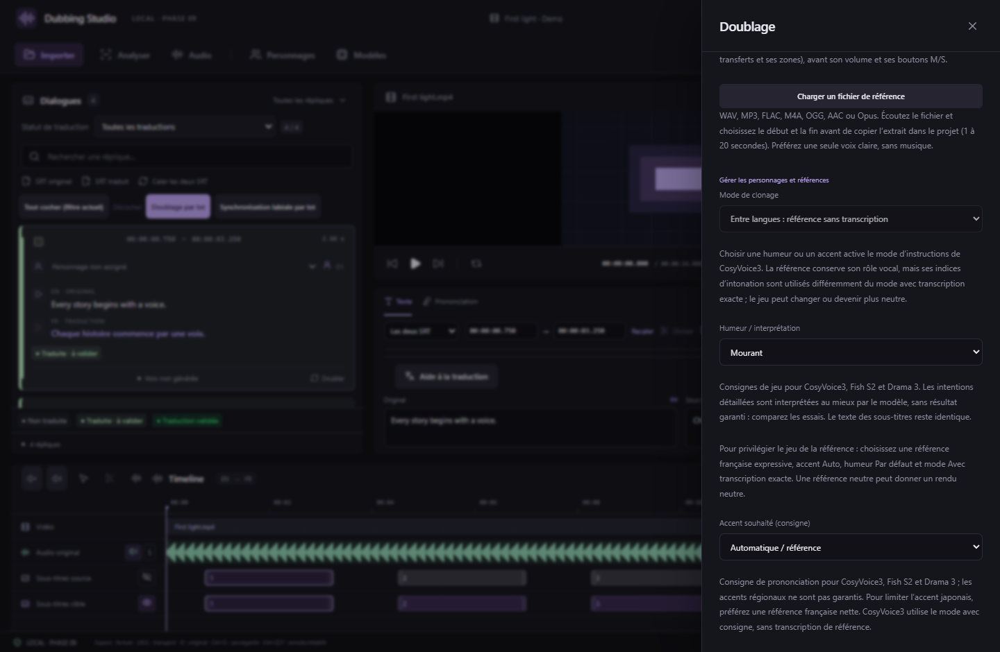

# Interprétation des doublages — v0.21.0

Dans **Doubler / Régénérer → Humeur / interprétation**, 43 choix remplacent la liste de sept choix. Le même sélecteur est disponible dans **Doublage par lot**. Une intention s’applique à la phrase entière ; il faut générer un nouvel essai pour l’entendre. Chaque essai conserve sa configuration et les essais précédents restent disponibles.

| Groupe | Intentions |
| --- | --- |
| Par défaut | Aucune consigne d’humeur ajoutée |
| Joie et affection | Joyeux, excité, enthousiaste, amusé, hilare, fier, tendre, soulagé |
| Tension et colère | En colère, stressé, anxieux, paniqué, effrayé, agacé, furieux, menaçant, déterminé, impatient |
| Tristesse et regrets | Triste, en pleurs, désespéré, déçu, plein de regrets, nostalgique |
| État physique | Mourant, épuisé, essoufflé, douloureux, somnolent, affaibli |
| Manière de parler | Calme, surpris, chuchoté, crié, sarcastique, ironique, perplexe, sceptique, curieux, sérieux, narrateur, dégoûté |

Ces intentions sont des **consignes de jeu en langage naturel**, pas 43 classes d’émotion garanties par chaque modèle. « Mourant » demande une voix faible, soufflée, qui s’éteint ; « hilare » demande de parler en riant. Le modèle peut atténuer, exagérer ou ignorer une consigne. Comparez les prises et privilégiez une référence dont le jeu convient à la scène. Aucun poids de modèle supplémentaire n’est nécessaire.

| Moteur intégré | Transmission de l’intention |
| --- | --- |
| CosyVoice3 | Instruction distincte du texte, via `inference_instruct2`. La transcription exacte de référence n’est pas utilisée dans ce mode. |
| Fish S2 FP8 et GGUF | Balise descriptive dans le prompt vocal ; la transcription exacte de la référence reste obligatoire. |
| Fish Audio Drama 3 FP8 | Même balise descriptive, avec le profil d’experts en RAM existant. La transcription exacte reste obligatoire. |
| Qwen3-TTS Base GGUF | Contrôle d’humeur indisponible dans le chemin Base intégré : sélecteur désactivé. |

Le catalogue partagé fournit des instructions chinoises pour CosyVoice3 et des descriptions anglaises pour Fish. Elles guident le moteur ; la phrase à prononcer et les SRT ne sont pas traduits ou modifiés par ce réglage. Les identifiants des sept anciens choix et leurs instructions restent inchangés.

## Accent français et expressivité avec CosyVoice3

Choisir **une humeur explicite ou un accent** fait passer le studio en mode d’instructions. Dans le frontend officiel CosyVoice3, `frontend_instruct2` supprime les jetons audio de référence qui conditionnent le modèle de langage. La référence continue à fournir des caractéristiques vocales, mais les indices de jeu ne sont plus utilisés comme en clonage avec transcription exacte. Cela peut expliquer un changement d’intonation ou un rendu plus neutre ; ce n’est pas un diagnostic universel de tous les essais.

Pour privilégier l’interprétation de la référence française :

1. Choisissez un extrait français propre, sans musique, **déjà expressif**, avec un jeu proche de la scène.
2. Utilisez **Accent : Auto**, **Humeur : Par défaut** et **Avec transcription exacte de la référence**.
3. Vérifiez la transcription de cet extrait français, puis générez une nouvelle prise pour comparer. Une référence neutre peut donner un rendu neutre.

Pour diriger une intention différente, choisissez ensuite une humeur et comparez : cela réactive le mode d’instructions. Une consigne ne garantit ni l’accent régional ni la reproduction exacte du jeu japonais.

Le transfert d’intonation existant reste une transformation acoustique expérimentale de hauteur, rythme et énergie. Il ne comprend pas les syllabes et ne réalise pas un transfert neuronal du jeu entre japonais et français. Augmenter son intensité ne corrige pas nécessairement une mauvaise intonation. [Limites et fonctionnement](PROSODY-TRANSFER.md).

## Projet et contrôle IA

Les nouveaux choix sont accessibles aussi dans les schémas MCP `VoiceSettings`, les options de génération et les lots. Le studio valide l’intention côté interface, serveur natif et worker. Les projets existants (formats 1 à 14) restent lisibles ; enregistrer un nouveau choix nécessite le **format 15**, à rouvrir avec v0.21.0 ou ultérieure. Les anciens choix conservent leur compatibilité de format.

Capture de l’interface React réelle avec média synthétique et commandes natives simulées. Les tests vérifient la configuration, les prompts, les formats et la conservation des essais ; ils ne mesurent pas la qualité subjective des 43 intentions sur RTX.

Sources : [instructions officielles CosyVoice3](https://huggingface.co/FunAudioLLM/Fun-CosyVoice3-0.5B-2512), [frontend officiel utilisé](https://github.com/QwenAudio/CosyVoice/blob/074ca6dc9e80a2f424f1f74b48bdd7d3fea531cc/cosyvoice/cli/frontend.py), [consignes ouvertes Fish S2](https://fish.audio/blog/fish-audio-s2-fine-grained-ai-voice-control-at-the-word-level/), [fiche officielle Drama 3](https://huggingface.co/fishaudio/drama-3).
