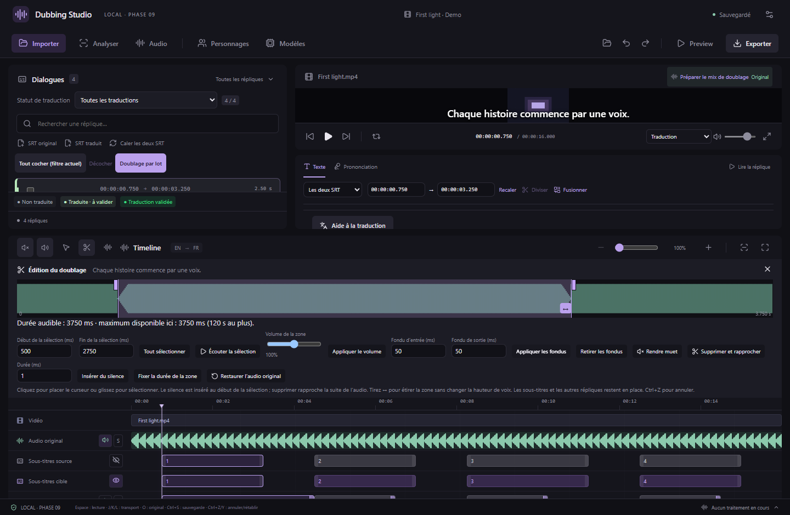
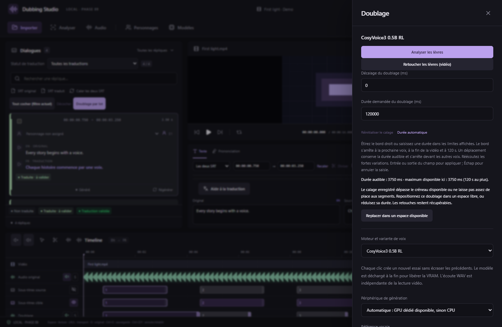

# Durée et déplacement des doublages

Disponible depuis **v0.15.1**. La durée maximale est calculée à partir de la position réelle du doublage : elle s’arrête à la prochaine voix ou à la fin de la vidéo, avec un plafond de **120 secondes par essai**. Le maximum disponible est affiché dans le panneau Doublage et dans l’éditeur de forme d’onde.

## Réglages protégés

| Opération | Comportement |
|---|---|
| Étirer le bord droit du bloc | La poignée s’arrête à la durée maximale disponible. |
| Saisir la durée ou le décalage | **Entrée** ou sortie du champ pour appliquer ; **Échap** annule la saisie. Une valeur invalide est refusée et la valeur précédente est réaffichée. Les nombres intermédiaires ne sont pas enregistrés pendant la frappe. |
| Déplacer un bloc, avec la souris ou les flèches | La durée audible est conservée. Le bloc se place dans l’espace libre le plus proche du point demandé et peut passer dans un autre intervalle assez grand. Il ne raccourcit pas les voix sous le pointeur. |
| Ajouter du silence | La durée du silence s’ajoute à la durée totale de l’essai. L’opération est refusée si ce total dépasse le maximum. |
| Étirer une sélection | Le contrôle porte sur **toute la voix après modification**, pas seulement sur la portion sélectionnée. La poignée est bornée ; une saisie trop longue est refusée. |
| Comprimer une voix découpée | Chaque segment conserve au moins 1 ms. La répartition des arrondis respecte la durée totale, même si les segments sont très inégaux. |
| Supprimer, rendre muet, changer le volume ou les fondus | Les limites sont vérifiées avant l’écriture. Une opération refusée conserve le projet et les fichiers audio. |

Exemple : une voix commence à 10,000 s et la suivante à 13,750 s. Le maximum est **3 750 ms**, même si le fichier généré ou la vidéo est plus long. Une voix de 2 000 ms dont on étire une portion de 500 ms peut donner à cette portion au plus **2 250 ms** : les 1 500 ms restantes doivent aussi tenir dans le créneau.

Les fortes accélérations ou ralentissements peuvent modifier la diction : réécoutez le résultat. Le plafond est une limite de traitement ; une durée de 120 secondes n’est disponible que si l’espace existe dans la vidéo.

## Récupérer un ancien calage problématique

Les projets enregistrés avec une version précédente restent ouvrables. Un message signale une durée demandée qui dépasse le créneau ou un créneau trop court pour ses segments.

Ouvrez **Doublage** pour la réplique, ou son éditeur de forme d’onde, puis utilisez **Replacer dans un espace disponible** :

- Si une ancienne durée explicite est trop longue, elle est ramenée à la durée réellement disponible à cette position.
- Si le bloc est sans créneau, superposé à un autre départ ou coincé en fin de vidéo, une place libre est cherchée pour lui redonner une durée utilisable.
- Si aucun espace ne peut le contenir, l’opération est refusée avec un message. Raccourcissez la voix ou libérez un intervalle, puis réessayez.

Les retouches restent enregistrées ; leur audio est recalculé pour le calage retenu. La correction peut être annulée ou rétablie et persiste après réouverture. Le format de projet reste inchangé : aucun nouveau format n’est introduit par cette correction.

La lecture, la forme d’onde, les paramètres et l’export emploient les mêmes limites. Le moteur natif refuse aussi un créneau supérieur à 120 secondes avant de lancer un rendu.

*Captures de l’interface React avec audio synthétique et commandes natives simulées. Les limites du traitement et l’export MKV sont testés séparément avec le véritable FFmpeg.*
