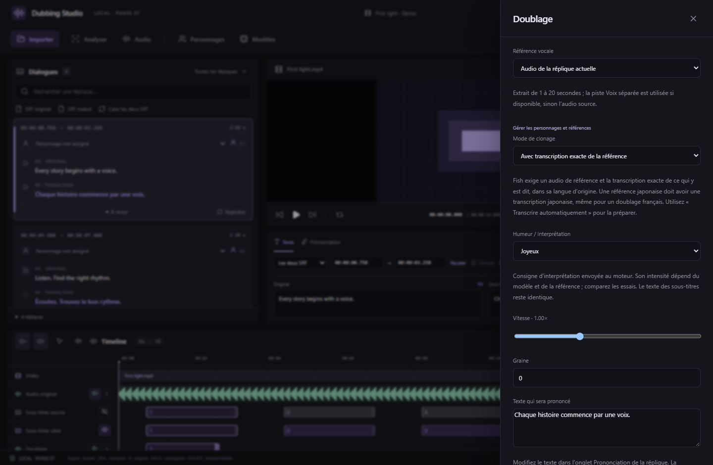

# Humeur des voix générées

Depuis v0.7.3, ouvrez **Doubler / Régénérer → Humeur / interprétation** avant de lancer un essai. Choisissez **Par défaut**, **En colère**, **Joyeux**, **Triste**, **Calme**, **Surpris** ou **Chuchoté**. Le choix est mémorisé par réplique et enregistré avec chaque essai pour faciliter les comparaisons. Il faut générer un nouvel essai pour changer son interprétation ; déplacer ou étirer une prise n’en change pas l’humeur.

| Moteur intégré | Fonctionnement |
| --- | --- |
| CosyVoice3 0.5B RL | Une humeur explicite utilise l’API officielle `inference_instruct2`, avec la référence audio et une instruction de style. Dans ce mode, la transcription de la référence n’est pas nécessaire et le sélecteur de clonage est désactivé. Par défaut conserve le mode de clonage choisi. |
| Fish S2 Pro FP8 E4M3 | Une balise de style est ajoutée au prompt vocal, par exemple `[angry]`. La transcription exacte de la référence reste nécessaire. |
| Fish S2 Pro GGUF Q8_0 | Même consigne de style, transmise au moteur audio.cpp. La transcription de la référence reste nécessaire. |
| Qwen3-TTS Base GGUF | Le chemin Base intégré ne propose pas les instructions d’humeur ; le sélecteur reste désactivé. |

Le texte des SRT reste identique et la consigne est séparée du texte mémorisé de la réplique. Les humeurs sont des indications probabilistes : le modèle, le contenu et la voix de référence influencent leur effet. Comparez plusieurs essais, surtout pour une réplique très courte. Le choix « Par défaut » n’ajoute aucune instruction.

Les instructions CosyVoice sont rédigées en chinois, comme dans les exemples amont ; elles sont envoyées dans le champ de consigne, séparées de la phrase française à prononcer. Ce choix n’est pas une traduction du dialogue. Les modèles existants ne nécessitent pas de nouveau téléchargement pour ce réglage. Une humeur explicite utilise le format de projet 7 ; conservez v0.7.3 ou ultérieure pour rouvrir le projet.

Capture React/Chrome avec génération et GPU simulés. Une inférence distincte a produit un WAV réel avec CosyVoice3 et l’humeur « Joyeux » sur CPU Windows ; le respect subjectif de l’émotion et les performances RTX ne sont pas quantifiés.

Sources des commandes utilisées : [exemples officiels CosyVoice](https://github.com/FunAudioLLM/CosyVoice/blob/main/example.py), [instructions Fish S2](https://fish.audio/ar/blog/fish-audio-s2-fine-grained-ai-voice-control-at-the-word-level/?articleLocale=en). Pour le texte de référence : [transcription automatique](REFERENCE-TRANSCRIPTION.md). Pour la synchronisation : [placement et durée](DUBBING-PLACEMENT.md).
