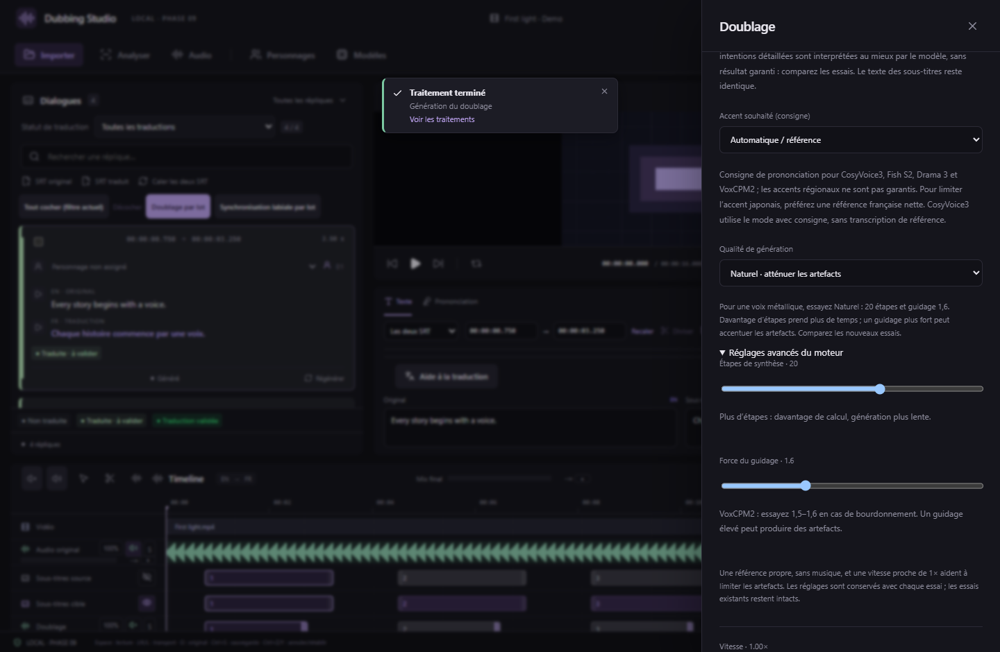

# Qualité de génération locale

Depuis la v0.27.0, le panneau **Doublage** propose **Qualité de génération**, pour une réplique et pour un lot. Les paramètres disponibles dépendent du moteur et sont appliqués à la synthèse. Aucun nouveau modèle ni service en ligne n’est nécessaire.

Pour une voix VoxCPM2 métallique, commencez par le profil **Naturel · atténuer les artefacts** : **20 étapes**, **guidage 1,6**. Comparez ensuite au profil Standard sur la même phrase, avec la même référence et la même graine. Ce profil constitue un point de départ ; il ne garantit pas la disparition de tous les défauts.

*Interface React réelle, média synthétique et commandes natives simulées. La génération neuronale est vérifiée séparément sous Windows avec les poids officiels, sur CPU ; aucune mesure de vitesse ni qualification GPU supplémentaire n’est revendiquée.*

1. Choisissez le moteur et une référence vocale propre.
2. Sélectionnez un profil dans **Qualité de génération**.
3. Ouvrez **Réglages avancés du moteur** pour ajuster les paramètres individuellement. Le profil devient **Personnalisé**.
4. Lancez **Générer un nouvel essai**, ou le lot prévu. Les essais précédents restent disponibles.
5. Écoutez d’abord le WAV seul, puis la lecture synchronisée. Un étirement important pour tenir dans un créneau peut produire ses propres artefacts.

**Standard · réglages actuels** retire les réglages personnalisés et conserve le comportement des versions précédentes. Changer de moteur remet ce choix sur Standard afin d’éviter de transmettre des paramètres incompatibles. Chaque essai conserve ses paramètres ; sa section **Qualité de génération** permet de les consulter. Les réglages appliqués apparaissent également dans les logs des moteurs Python.

## Réglages par moteur

| Moteur | Profils | Réglages avancés |
| --- | --- | --- |
| VoxCPM2 2B BF16 | Standard, Rapide, Naturel, Détaillé | 4–30 étapes ; guidage 1–3 |
| CosyVoice3 | Standard, Rapide, Détaillé | 6–30 étapes du décodeur acoustique |
| Fish S2 FP8 | Standard, Stable, Expressif | Température, Top P, pénalité de répétition |
| Fish S2 GGUF | Standard, Stable, Expressif | Température, Top P, Top K |
| Fish Audio Drama 3 FP8 | Standard, Stable, Expressif | Température, Top P, Top K |
| Qwen3-TTS 0.6B/1.7B GGUF | Standard, Stable, Expressif | Température, Top P, Top K, pénalité de répétition |
| Chatterbox Multilingual V3 | Standard, Stable, Expressif | Température, Top P, Min P, pénalité de répétition, guidage de référence, expressivité |

Davantage d’étapes demande plus de calcul. Le profil Détaillé n’est pas forcément meilleur sur toutes les voix. Les profils Stable et Expressif règlent la diversité de l’échantillonnage ; ils ne constituent pas des niveaux de qualité mesurés. Les poids, la quantification BF16/FP8/GGUF, le périphérique sélectionné et le cache d’experts Drama 3 restent ceux de la variante choisie.

Pour VoxCPM2, le guide officiel recommande d’essayer un guidage de 1,5–1,6 en cas de bourdonnement. Un guidage trop élevé peut renforcer certains artefacts. Pour Chatterbox avec une référence japonaise et un texte français, Standard garde le guidage à **0**, conformément à la recommandation du projet pour limiter le transfert de langue ; l’augmenter peut également renforcer l’accent de la référence.

Une référence isolée, sans musique, bruit, saturation ou réverbération marquée, aide davantage qu’une augmentation systématique des curseurs. Préférez plusieurs secondes de parole naturelle et une vitesse proche de 1×. Si le WAV seul est propre mais la timeline sonne métallique, comparez la vitesse et l’ajustement de durée avant de changer les paramètres de synthèse. Aucun filtre de « restauration » n’est ajouté automatiquement. Les essais restent au format WAV PCM 24 kHz du studio ; ce réglage ne convertit pas tout le pipeline vers une nouvelle fréquence.

## Lots, sauvegarde et MCP

Les réglages choisis pour un lot s’appliquent à chaque nouvel essai. Le modèle reste chargé pendant le lot, et les paramètres de la requête sont réappliqués à chaque réplique. Revenir au profil Standard rétablit les valeurs standard, même dans une session déjà chargée. La libération en fin de lot ou lors de l’annulation reste assurée par l’arrêt du processus de génération.

Les projets contenant des réglages de qualité passent au **format 19**. Les projets précédents restent lisibles ; leurs anciens essais et réglages ne sont pas réécrits. Les anciennes versions du studio ne peuvent pas ouvrir un projet enregistré au format 19.

Le studio expose **101 outils MCP**. `studio_voice_quality_catalog` donne les paramètres, bornes, valeurs standard et profils des huit variantes disponibles. Passez par exemple `quality: { "inferenceSteps": 20, "cfgStrength": 1.6 }` dans les options `VoiceSettings` d’un nouvel essai ou d’un lot VoxCPM2. L’absence de `quality` conserve les réglages standard. Les paramètres inconnus, non finis, hors limites ou incompatibles avec le moteur sont refusés avant le chargement des poids. Le catalogue est partagé entre interface, validateurs Rust et workers Python.

Sources de l’intégration : [guide officiel VoxCPM](https://voxcpm.readthedocs.io/en/latest/usage_guide.html#quality-tuning), [VoxCPM2](https://huggingface.co/openbmb/VoxCPM2), [Chatterbox](https://github.com/resemble-ai/chatterbox), [options Fish GGUF v0.9.1](https://github.com/0xShug0/audio.cpp/blob/v0.9.1/model_specs/fish_audio.json), [options Qwen3-TTS GGUF v0.9.1](https://github.com/0xShug0/audio.cpp/blob/v0.9.1/model_specs/qwen3_tts.json). Les autres paramètres correspondent aux API vendorizées et épinglées dans `workers/vendor`.
