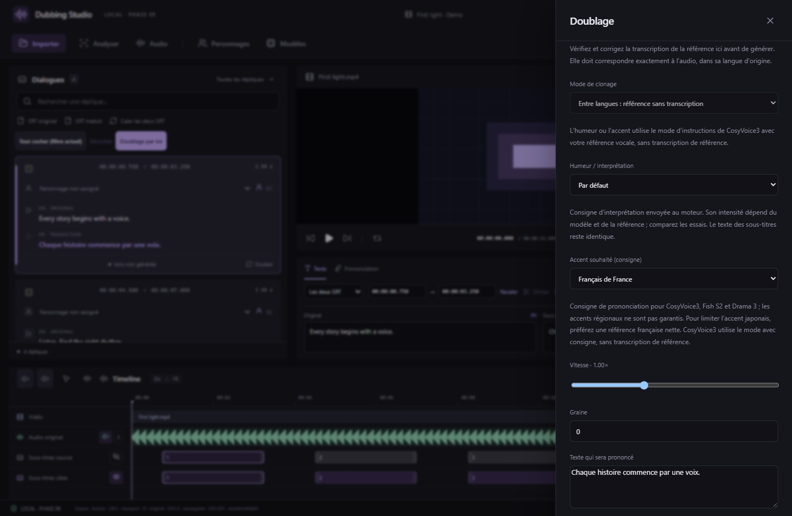

# Fichiers de référence et accents

Disponible dans **v0.10.3**, dans le panneau **Doublage** de chaque réplique.

## Charger directement un fichier audio

1. Ouvrez une réplique avec **Doubler** ou **Régénérer**.
2. Cliquez sur **Charger un fichier de référence** et sélectionnez un WAV, MP3, FLAC, M4A, OGG, AAC ou Opus.
3. À partir de v0.11.0, écoutez le fichier et choisissez le **début et la fin** de l’extrait avant **Utiliser cet extrait**. Le studio copie cette portion de **1 à 20 secondes** dans le projet, en WAV mono PCM 16 bits à 24 kHz. [Guide des extraits et du doublage par lot](BATCH-DUBBING.md). Plusieurs secondes de parole claire, sans musique, donnent une meilleure référence.
4. Écoutez la référence avec le lecteur du panneau. Pour Fish S2, Drama 3 ou le mode CosyVoice3 avec transcription, renseignez **Texte réellement prononcé** ou utilisez **Transcrire automatiquement**, puis corrigez le résultat si nécessaire. La transcription décrit exactement l’audio dans sa langue d’origine, indépendamment du texte français à générer.
5. Générez un nouvel essai. Le fichier apparaît dans **Référence vocale → Fichier audio importé**, puis dans la liste des références : il peut être réutilisé pour d’autres répliques sans créer de personnage.

La copie reste disponible si le fichier d’origine est déplacé. L’import et sa sélection forment une opération annulable ; annuler le sélecteur de fichier ou échouer à décoder un fichier conserve la référence précédente. Le texte saisi ou transcrit est sauvegardé avec la référence. Les références de personnages et l’extraction de la réplique actuelle restent disponibles.

Interface React réelle ; fichier, commandes natives et inventaire simulés pour la capture. Un test natif distinct importe réellement un MP3 stéréo de 21 secondes, le convertit et vérifie la limite de 20 secondes, la copie, la réouverture et l’annulation.

## Demander un accent français

Pour une langue cible **française**, **Accent souhaité (consigne)** propose Automatique/référence, Français de France, du Québec, de Belgique ou de Suisse. Le choix est enregistré dans les paramètres de la réplique et de chaque nouvel essai, sans changer les SRT ni la transcription de référence.

| Moteur intégré | Transmission de la consigne |
| --- | --- |
| CosyVoice3 | Mode `inference_instruct2`, combiné à l’humeur ; utilise toujours l’audio de référence, sans son texte dans le conditionnement du modèle de langage. |
| Fish S2 FP8 et GGUF | Direction de style en préfixe, distincte du texte affiché, combinée à l’humeur. Le texte exact de référence reste nécessaire. |
| Drama 3 FP8 | Même direction de style transmise au moteur Drama ; transcription de référence nécessaire. |
| Qwen3-TTS Base | Choix désactivé : les variantes Base intégrées n’exposent pas ce contrôle dans le studio. |

**Il s’agit d’une consigne, pas d’une garantie ni d’un correcteur d’accent après génération.** Les moteurs acceptent des instructions de style, mais leur respect des accents régionaux français n’a pas été qualifié sur la RTX 5060 Ti. Une voix japonaise peut encore transmettre son accent. Pour obtenir un français plus naturel, importez une référence parlée en français ; le timbre suivra aussi cette nouvelle référence. Comparez plusieurs essais.

L’accent reste automatique pour les autres langues cibles et les moteurs incompatibles. Les nouveaux paramètres utilisent le **format de projet 9**, qui demande v0.10.3 ou ultérieure ; les anciens projets restent lisibles.

Sources des interfaces d’instructions : [CosyVoice officiel](https://github.com/QwenAudio/CosyVoice), [Fish S2 Pro](https://huggingface.co/fishaudio/s2-pro), [moteur communautaire Drama 3](https://github.com/PedroMarinhoDev/ComfyUI-Drama3). Les présélections françaises du studio expriment une demande ; elles ne constituent pas des profils d’accent certifiés par ces projets.
