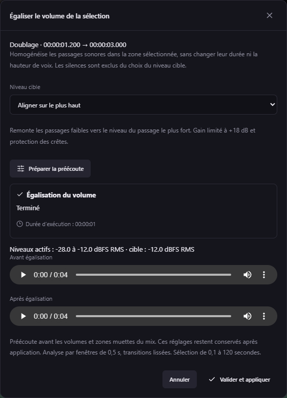

# Égaliser le volume d’une sélection — v0.47.0

1. Sélectionnez une zone sur une piste audio dans la timeline (outil de sélection, ou Maj + glisser).
2. Faites **clic droit dans la zone → Égaliser le volume…**.
3. Choisissez **Aligner sur le plus bas** pour atténuer les passages forts, ou **Aligner sur le plus haut** pour remonter les passages faibles.
4. Cliquez sur **Préparer la préécoute**, puis comparez **Avant égalisation** et **Après égalisation**. Une seule écoute reste active à la fois. La préparation affiche sa progression et sa durée dans cette fenêtre.
5. **Valider et appliquer** remplace le son de cette zone par le résultat préécouté, au même timestamp. La fenêtre se ferme et la sélection disparaît. Fermer ou annuler conserve la sélection et n’applique rien.

Disponible sur Original, Voix, Musique, Effets, pistes ajoutées et Doublage. Une sélection doit couvrir 0,1 à 120 secondes et rester dans la durée de la piste. Le clic droit utilise la sélection courante, même lorsqu’elle ne couvre qu’une partie d’une zone de volume existante.

Le traitement travaille **avant les volumes et zones muettes du mix** ; ces réglages restent en place. Il utilise le son courant, y compris les remplacements déjà appliqués. Sur Doublage, il tient compte des essais sélectionnés, des décalages, durées et éditions audio. Seuls les essais qui intersectent la sélection sont préparés ; aucun rendu de la vidéo entière n’est nécessaire.

Sur Doublage, la couche d’égalisation est liée aux prises et au montage utilisés. Choisir une autre prise, déplacer/étirer une voix ou modifier son montage désactive cette couche sur la sélection concernée, pour laisser entendre le nouveau choix. Les anciens essais et la couche restent conservés ; retrouver exactement les mêmes prises et le même calage réactive la couche. Une modification d’une réplique hors de la zone n’impose pas de recalcul.

Les niveaux RMS sont mesurés par fenêtres de 0,5 seconde avec un gain lié entre les deux canaux et des transitions lissées. Les fenêtres sous −60 dBFS RMS ou plus de 30 dB sous le passage le plus fort sont exclues du choix du niveau cible. Les silences numériques restent silencieux. Le gain est plafonné à environ +18 dB et une atténuation commune protège les crêtes à 0,98 avant les réglages du mix ; l’interface signale ces limites. Un alignement parfait n’est donc pas garanti pour les signaux très disparates. La durée, le rythme et la hauteur de voix restent inchangés.

La validation ajoute une couche audio indépendante et annulable avec **Ctrl+Z**. Les fichiers source, sous-titres et essais ne sont jamais écrasés. Le format du projet passe à **27** lors de la première application ; utilisez v0.47.0 ou ultérieure pour rouvrir ce projet. Un aperçu d’un projet modifié entre-temps est refusé : préparez-le à nouveau. Les fichiers temporaires de préécoute sont retirés à l’annulation ou après application.

Une nouvelle application qui couvre entièrement des égalisations actives les regroupe dans le nouveau résultat, pour éviter d’accumuler des couches redondantes. Leurs WAV restent disponibles pour l’annulation ; les égalisations liées à d’autres essais restent conservées.

Le MCP expose le même parcours : `studio_prepare_volume_leveling` → `studio_list_jobs` → `studio_volume_leveling_result` / `studio_volume_leveling_path` (rôle `original` ou `leveled`) → `studio_apply_volume_leveling` ou `studio_discard_volume_leveling`. La préparation et l’application exigent le projet et la révision courants ; aucune application automatique après redémarrage.
