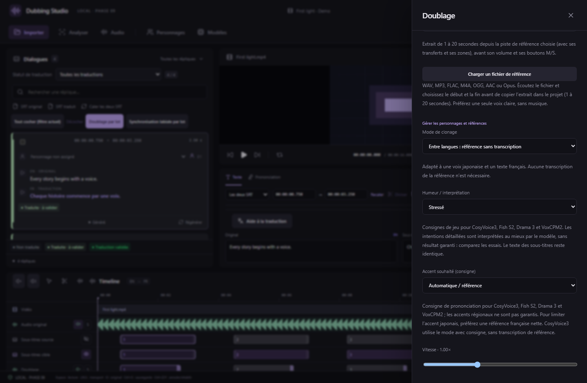
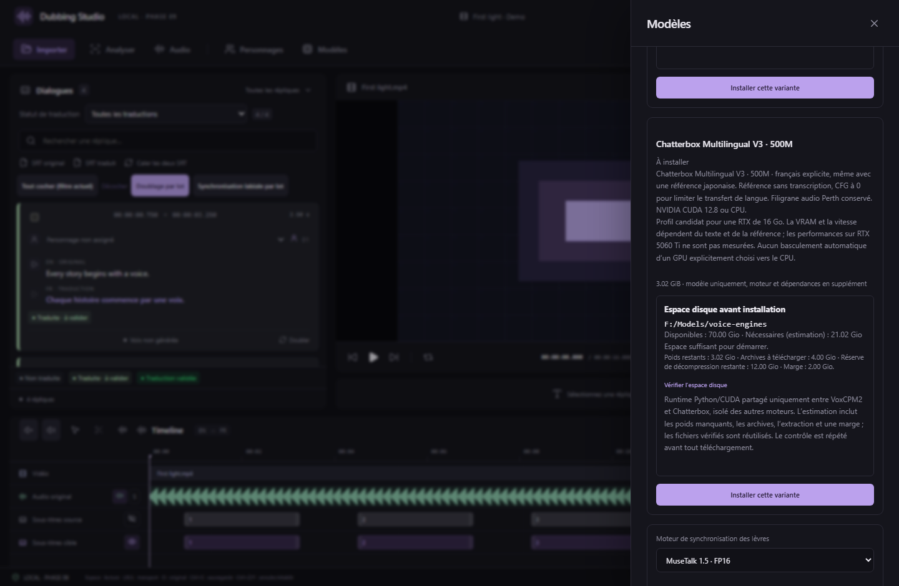

# VoxCPM2, Chatterbox Multilingual et langue de Drama 3

Disponible à partir de **v0.22.0**. Les deux moteurs s’installent et génèrent des essais dans le studio, par réplique ou en lot. Chaque génération produit un nouveau WAV ; les essais précédents restent disponibles.

## Installation

1. Dans **Paramètres → Stockage des modèles**, choisissez le disque à utiliser.
2. Ouvrez **Modèles**, puis la carte **VoxCPM2 · 2B · BF16** ou **Chatterbox Multilingual V3 · 500M**.
3. Vérifiez l’espace **disponible / nécessaire**, puis cliquez sur **Installer cette variante**. Le studio contrôle à nouveau l’espace avant le premier téléchargement.
4. Attendez la fin du traitement. Les fichiers sont vérifiés par taille et SHA-256 ; une installation interrompue peut être relancée pour réutiliser les fichiers complets vérifiés.

Les poids occupent environ **4,62 Gio** pour VoxCPM2 et **3,02 Gio** pour Chatterbox. Ce sont des tailles de fichiers, pas des mesures de VRAM. La première installation ajoute un environnement Python et CUDA : l’estimation inclut les archives, l’extraction et une marge. Les deux nouveaux moteurs partagent cet environnement ; les environnements CosyVoice, Fish et Drama restent séparés.

## Générer une réplique française

Choisissez le français comme langue cible du projet, puis **Doubler / Régénérer**. Sélectionnez le moteur, votre **NVIDIA GeForce RTX 5060 Ti**, la référence audio et **Générer un nouvel essai**. Le texte à prononcer est celui de la traduction ou de l’onglet Prononciation. La référence sert à la voix ; son texte ne remplace pas la traduction.

| Réglage | VoxCPM2 | Chatterbox Multilingual V3 |
|---|---|---|
| Français / référence japonaise | Français pris en charge ; langue portée par le texte | Jeton de langue `fr` explicite ; CFG à 0 pour limiter le transfert de langue |
| Mode sans transcription | Interlangue, référence isolée par le modèle | Mode unique de cette intégration |
| Mode avec transcription | Continuation ; texte exact dans la langue de la référence | Inutile, contrôle désactivé |
| Humeurs / accents régionaux | Consignes descriptives entre parenthèses, résultat variable | Désactivés dans cette intégration ; aucune fausse promesse de contrôle sémantique |
| Calcul | BF16 sur CUDA ; FP32 sur CPU | FP32 sur CUDA ou CPU |
| Sortie enregistrée | WAV mono PCM16, 24 kHz | WAV mono PCM16, 24 kHz ; filigrane Perth conservé |

Une référence française expressive et propre reste le meilleur point de départ pour limiter l’accent japonais. Une référence japonaise peut transmettre une partie de son accent ou de son jeu, même avec un texte français. Comparez les essais ; aucune qualité émotionnelle ou fidélité d’accent n’est garantie.

Captures de l’interface React réelle, avec média synthétique et commandes natives simulées. Elles illustrent les contrôles ; les tests de génération réelle sont décrits dans [VALIDATION](../VALIDATION.md).

## Lots, mémoire et compatibilité

Le panneau **Doublage par lot** propose les mêmes moteurs et réglages. Un worker garde le modèle chargé entre les répliques ; la fin, l’échec ou l’annulation libère le processus et ses allocations. Une requête explicitement adressée à un GPU ne bascule pas silencieusement vers le CPU.

Ces profils sont des candidats pour votre RTX de 16 Go. Le studio n’intègre pas de conversion GGUF/FP8 non testée pour ces deux moteurs : le profil officiel BF16 de VoxCPM2 et le profil multilingue FP32 de Chatterbox sont utilisés. La vitesse et le maximum de VRAM sur RTX 5060 Ti ne sont pas mesurés par les tests CPU.

L’enregistrement d’un de ces moteurs utilise le **format de projet 16**, nécessitant v0.22.0 ou ultérieure. Les anciens projets restent lisibles. Les réglages, la sélection d’essai, le mixage et les exports continuent d’utiliser le même projet.

## Correction de Drama 3 avec une référence japonaise

L’intégration précédente transmettait la traduction française, mais **sans consigne de langue lorsque l’accent était sur Auto**. Sur une réplique courte, le conditionnement audio et la transcription japonaise pouvaient entraîner une sortie dans une autre langue.

Drama 3 reçoit maintenant une consigne explicite de **langue cible à chaque morceau de texte**, y compris avec **Accent Auto**. La transcription exacte de la référence reste séparée, dans sa langue d’origine. Les éventuelles consignes d’accent et d’humeur restent applicables ; les paramètres d’échantillonnage ne sont pas changés par cette correction. Les journaux indiquent la langue et le texte cible pour faciliter le diagnostic.

Ce guidage corrige le défaut de conditionnement identifié ; il ne constitue pas un détecteur automatique garantissant chaque mot ou chaque accent. Si un essai reste incorrect, utilisez une référence française, vérifiez la transcription japonaise et comparez une autre graine. Les anciens essais ne sont ni modifiés ni retraduits.

Pour appliquer la correction à une ancienne prise, générez un nouvel essai. En lot, cochez **Forcer un nouvel essai** pour retraiter les répliques qui possèdent déjà un doublage. Les prises précédentes restent conservées.

## MCP

Utilisez `studio_install_voice_runtime` avec `variantId` égal à `voxcpm2-bf16` ou `chatterbox-multilingual-v3`. `studio_voice_install_space` accepte le même argument facultatif ; sans argument il conserve son comportement historique pour Drama 3.

`studio_generate_line`, `studio_generate_dubbing_batch`, les prévisualisations de lots, les jobs et l’annulation partagent ces variantes. Pour Chatterbox : `mode: "crossLingual"`, `mood: "default"`, `accent: "auto"`. Lire l’état et fournir le contexte de révision courant reste nécessaire pour les mutations.

## Sources et profils épinglés

- [VoxCPM officiel](https://github.com/OpenBMB/VoxCPM), paquet 2.0.3 ; [VoxCPM2 officiel](https://huggingface.co/openbmb/VoxCPM2), révision `32279effe8c19989596f05d353d1447f51d9e915`, Apache 2.0.
- [Chatterbox officiel](https://github.com/resemble-ai/chatterbox), source `5de7a54aa4e5e2baadb0182dde554908b48b85c2` ; [poids officiels](https://huggingface.co/ResembleAI/chatterbox), révision `5bb1f6ee58e50c3b8d408bc82a6d3740c2db6e18`, MIT. Le code V3 est conservé avec licence et description des adaptations locales dans `workers/vendor/chatterbox/`.
- Dépendances, poids, empreintes et URL sont enregistrés dans `workers/multilingual-runtime.json` et `workers/voice-engines.json`. PyTorch 2.8 / CUDA 12.8 est épinglé pour le profil NVIDIA ; les dépendances de démonstration, entraînement et serveur web ne sont pas lancées.

Le tokenizer chinois de Chatterbox utilise son modèle pkuseg épinglé dans le même dossier de stockage (archive de 33 Mio incluse dans le calcul), sans téléchargement caché vers le profil Windows.
