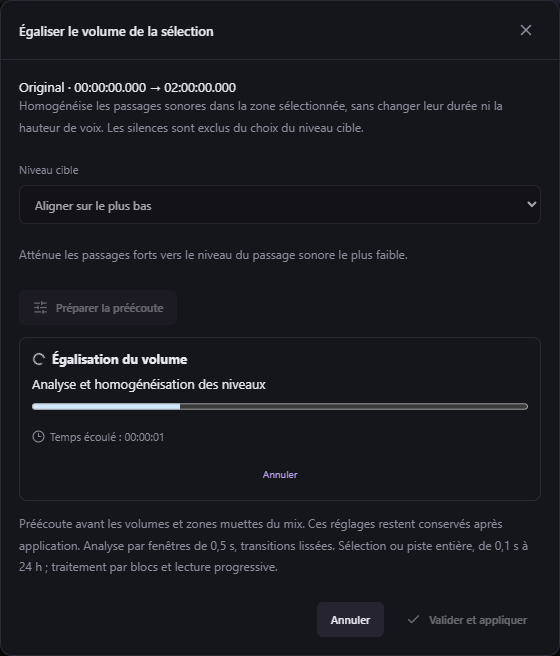

# Égaliser une piste entière — v0.48.0

1. Faites **clic droit sur la piste audio → Égaliser toute la piste…**. Aucune sélection préalable n’est nécessaire.
2. Choisissez **Aligner sur le plus bas** ou **Aligner sur le plus haut**, puis **Préparer la préécoute**.
3. Écoutez **Avant égalisation** et **Après égalisation**, avec déplacement libre dans les lecteurs. La progression et le temps écoulé restent dans cette fenêtre ; vous pouvez annuler la préparation.
4. **Valider et appliquer** applique exactement le résultat préécouté, au même emplacement. La fenêtre se ferme et toute sélection audio est effacée. Fermer ou annuler laisse la piste inchangée.

Disponible sur Original, Voix, Musique, Effets, pistes ajoutées et Doublage. La durée est celle de la piste, dans la limite de la vidéo et de 24 heures. Les sélections de plus de 120 secondes sont également acceptées par **Égaliser le volume…**. Les autres outils audio gardent leurs limites respectives.

Une seule cible est calculée sur **toute la plage**, à partir des fenêtres sonores de 0,5 seconde. Le traitement lit le PCM en trois passes avec un petit tampon, sans conserver la piste entière en mémoire. Les transitions, le gain stéréo commun, la protection des crêtes et la limite d’amplification de +18 dB sont conservés. Les silences restent silencieux ; la durée et la hauteur de voix ne changent pas. Les sons très faibles sous les seuils d’analyse ne deviennent pas la cible.

La lecture avec la vidéo ne décode que des fragments PCM de 30 secondes proches du curseur pour les longues couches. Les fragments consécutifs se rejoignent à l’échantillon exact et sont planifiés par l’horloge audio. Les déplacements dans la vidéo, les volumes, zones muettes et remplacements restent disponibles. Une piste de plusieurs heures ne devient pas un unique tampon audio dans le navigateur.

Les fichiers temporaires et la nouvelle couche occupent de l’espace disque : une vérification conservatrice précède le traitement, puis une autre précède la copie finale. Un WAV stéréo 48 kHz/16 bits représente environ **659 Mio par heure**. Les fichiers dépassant la limite RIFF de 4 Gio utilisent RF64 ; leurs préécoutes dans l’interface utilisent FLAC sans perte pour conserver une lecture et une navigation compatibles.

Les sources, sous-titres et essais existants restent intacts. **Ctrl+Z** annule l’application. Pour Doublage, la couche reste liée aux essais et au calage utilisés ; modifier ces entrées désactive l’ancienne égalisation jusqu’à leur restauration ou à une nouvelle préparation. Une révision périmée ne peut pas être appliquée.

Une égalisation de plus de 120 secondes fait passer le projet au **format 28** : utilisez v0.48.0 ou ultérieure pour le rouvrir. Les projets plus anciens restent lisibles. Le format des petites sélections reste 27.

Le MCP conserve les mêmes outils et le même parcours en deux phases : `studio_prepare_volume_leveling` accepte une plage de 0,1 seconde à 24 heures, puis `studio_list_jobs`, `studio_volume_leveling_result` et `studio_volume_leveling_path` permettent la préécoute. `studio_apply_volume_leveling` exige toujours une validation explicite et la révision courante. `studio_discard_volume_leveling` abandonne le résultat. `studio_audio_patch_path` accepte aussi `startMs` / `endMs` relatifs à la couche pour lire un fragment de 30 secondes maximum ; sans ces options, il renvoie le fichier PCM complet.
